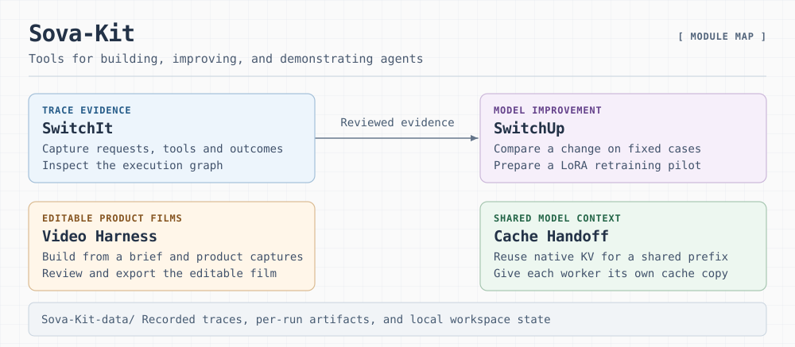

# Sova-Kit

Sova-Kit is a toolkit for teams building agents. Inspect how an agent handled a task, verify a change against the outcomes that matter, reuse model context across workers, and make editable films that show the product in action.

## Modules

| Module | Use it when | What you get |
| --- | --- | --- |
| [SwitchIt](SwitchIt/README.md) | You need to understand an agent run or prepare to switch providers. | A trace with the request, model and tool steps, and the outcomes the source can verify. |
| [SwitchUp](SwitchUp/README.md) | You have a failed decision and a reviewed correction to try. | A comparison on fixed cases, versioned instruction changes, and a separate LoRA training pilot. |
| [Video Harness](video-harness/README.md) | You need to show a real workflow for a launch, onboarding, or a design review. | An editable film project, a local preview, and an MP4 export. |
| [Cache Handoff](sova-cache-handoff/README.md) | Workers using the same model start from a common block of context. | Native KV state that the engine can copy and reuse for a matching token prefix. |

## From a trace to an improvement

If a support agent cancels an order before checking approval, use SwitchIt to find the request, the cancellation call, and its effect. Give SwitchUp the reviewed correction and compare the active and proposed instructions on the same cases. After verifying the change, use Video Harness to show the approval step in a product walkthrough. [Trace guide](SwitchIt/Traces/README.md) · [Improvement guide](SwitchUp/docs/switchup.md) · [Film workflow](video-harness/README.md)

## Start locally

The SwitchIt Python package provides both `switchit` and `switchup`. Install it from the kit root with `python -m pip install ./SwitchIt`. The Video Harness and Cache Handoff guides have their own installation steps.

## Data directory

SwitchIt and SwitchUp store generated data in the sibling `Sova-Kit-data/` directory. `traces/` holds the recorded evidence and audits. `runs/sagemaker/` holds the input bundle for each training job. `workspace/` holds local captures, improvement rounds, and workflow jobs. Set `SOVA_KIT_DATA_DIR` to use a different data root.
