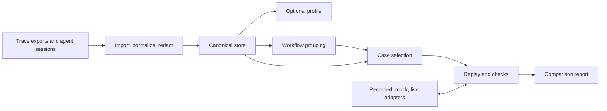
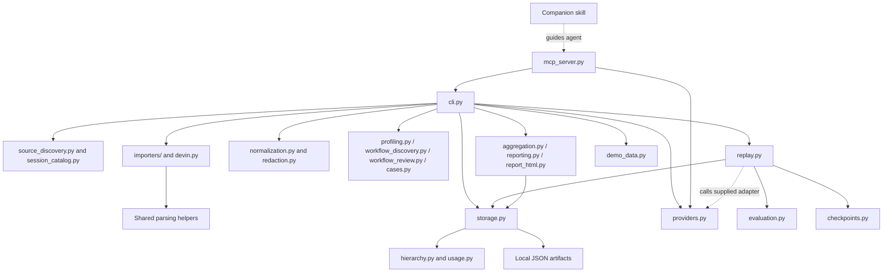

# SwitchIt! module map

Updated on 9 November 2026 for the local Python module extraction based on commit `461bf79`. This describes the working tree; proposed capabilities are marked separately. Python package: 0.1.5. JavaScript package: 0.1.1. Release versions remain unchanged. Following extraction, independent workflow modules and replay correctness fixes were added locally; see the implementation contracts below.

## Product-level flow



The default Python `run` command executes import → map → cases → replay → report. `profile` is a separate command reading the imported store. Editing a workflow map or case file is an intentional review point between stages.

## Python implementation: primary harness

The Python implementation now has explicit source modules. The previous `core.py`, `agent_sessions.py`, and `runner.py` paths remain compatibility facades; new implementation code and tests should target the owners below. The CLI imports those owners directly.

| Logical module | Responsibility | Implementation | Main output |
| --- | --- | --- | --- |
| Entry points and orchestration | Parse commands, choose paths and adapters, run stages | [cli.py](../switchit/cli.py), [__main__.py](../switchit/__main__.py), [pyproject.toml](../pyproject.toml) | Stage execution and console output |
| Source discovery | Find supported local session files without parsing transcripts | [source_discovery.py](../switchit/source_discovery.py) | Agent/path inventory |
| Session catalog | Read Codex catalog metadata, collect titles/origins, create discovery-only stubs | [session_catalog.py](../switchit/session_catalog.py) | Metadata and task-level records |
| File importers | Parse JSON/JSONL, OTLP, Langfuse-style exports, Parquet | [importers/files.py](../switchit/importers/files.py) | Raw call records |
| Agent-session importers | Read each agent format; dispatch explicitly selected paths | [importers/](../switchit/importers), [registry.py](../switchit/importers/registry.py), [common.py](../switchit/importers/common.py) | Raw calls and source IDs |
| Devin importer | Fetch authorized cloud session metadata and convert it to task records | [devin.py](../switchit/devin.py) | Task-level metadata, not full model-call recordings |
| Import orchestration | Run selected file importers, normalize records, assemble a store | [ingestion.py](../switchit/ingestion.py): `import_store` | Canonical store document |
| Redaction | Redact messages, tool schemas, values, and bounded excerpts | [redaction.py](../switchit/redaction.py) | Sanitized content |
| Normalization | Convert raw records into the existing canonical call format | [normalization.py](../switchit/normalization.py): `make_call` | Canonical calls |
| Usage accounting | Normalize and aggregate recorded, estimated, and unknown usage separately | [usage.py](../switchit/usage.py) | Usage counters with provenance |
| Trace/session hierarchy | Aggregate ordered calls into traces and group traces into sessions | [hierarchy.py](../switchit/hierarchy.py): `build_traces`, `build_sessions` | Existing containment hierarchy, not a causal execution graph |
| Store and persistence | Assemble the store and atomically write local JSON artifacts | [storage.py](../switchit/storage.py) | `store.json` and shared persistence helpers |
| Profile analysis | Extract prompts, tool inventory, inferred argument schemas, provider mix, usage and errors | [profiling.py](../switchit/profiling.py): `build_profile`, `infer_tool_schema` | `profile.json`, `app_config.inferred.json` |
| Workflow discovery | Group traces using text similarity and tool overlap | [workflow_discovery.py](../switchit/workflow_discovery.py): `group_workflows` | Provisional workflow groups |
| Workflow review | Save/load maps and preserve reviewed edits when requested | [workflow_review.py](../switchit/workflow_review.py): `apply_edits` | `workflows.json`; not an executable workflow builder |
| Case selection and fixtures | Select common, costly, risky, failed cases; attach reference behavior, default checks and recorded tool fixtures | [cases.py](../switchit/cases.py): `select_cases`, `default_checks` | `cases.json` |
| Provider adapters | Convert requests/responses and provide recorded, mock, OpenAI-compatible, Anthropic and Bedrock interfaces | [providers.py](../switchit/providers.py) | Normalized replay results and capability declarations |
| Replay engine | Run selected cases, optionally continue with recorded fixtures, checkpoint and resume | [replay.py](../switchit/replay.py): `run_replay`, `replay_case`, `_chain_target_turns` | `results.json`, `run_state.json` |
| Checkpoints | Calculate run identity and load resumable state | [checkpoints.py](../switchit/checkpoints.py) | Run fingerprint and saved state |
| Evaluation | Evaluate declared checks, compare tools, classify pass/fail/error/uncertain | [evaluation.py](../switchit/evaluation.py): `evaluate_check`, `compare_tools`, `finalize_case` | Per-case verdicts and findings |
| Aggregation | Aggregate findings, usage and capability gaps; prioritize fixes | [aggregation.py](../switchit/aggregation.py): `aggregate` | Run summary |
| Reporting | Assemble/persist reports and render self-contained HTML | [reporting.py](../switchit/reporting.py), [report_html.py](../switchit/report_html.py) | `report.json`, `report.html` |
| MCP interface | Expose pipeline and inspection operations through stdio JSON-RPC | [mcp_server.py](../switchit/mcp_server.py) | Agent-callable tools |
| Synthetic demonstration | Provide bundled records without reading personal traces | [demo_data.py](../switchit/demo_data.py), [examples](../examples) | Demonstration inputs |

Local importer functions cover Claude Code, Codex, Cursor, OpenCode, Cline, Aider, Gemini CLI, Copilot CLI, Muse, and Grok Build. Discovery and source completeness vary by format. Catalog-only cloud/Dot records are title-level stubs: discovery evidence, not replayable transcripts.

Capability presence is not a correctness certification. The preceding review documented replay and adapter defects; see the [prospectus](switchit-prospectus-2026-11-09.md).

## Independent workflow implementation

The evidence-to-workflow path is available as independent modules and through `workflow`, `sources`, and `harness` CLI namespaces. The original replay pipeline remains available. See [module-contracts.md](module-contracts.md) for APIs, data contracts, individual test commands, the offline demo, and integration limits.

```text
source_inventory → import_pipeline → events/event_store
                                     ↓
execution_graph → dependencies + workflow_patterns
                                     ↓
workflow_builder → workflow_cases + fixtures
                                     ↓
recipes/composer → runtime_adapters + workflow_runner
                                     ↓
workflow_evaluation → promotions
```

The original `hierarchy.py` still provides legacy call/trace/session containment; `execution_graph.py` owns the richer event graph. Likewise, `workflow_review.py` handles legacy grouping edits while `workflow_builder.py` owns the new reviewed specification. These are different formats, not duplicate implementations of the same contract.

## Actual dependency structure



The CLI is the orchestrator. The MCP server invokes command handlers for pipeline work and contains its own status/report-reading operations. The skill supplies agent instructions; it does not execute the harness by itself.

Domain modules do not import the legacy facades. Importing a parser, discovery, hierarchy, workflow discovery, or evaluation module does not eagerly load the CLI, providers, replay, or reporting. Package-level `switchit.core`, `switchit.providers`, and `switchit.runner` attributes are resolved lazily for compatibility.

Python exposes ten MCP tool names: `switchit_import`, `switchit_profile`, `switchit_map`, `switchit_cases`, `switchit_replay`, `switchit_report`, `switchit_run`, `switchit_status`, `switchit_read_report`, and `switchit_list_providers`. This is an inventory of declared tools, not a fresh functional test of every route.

## Data artifacts and boundaries

```text
.switchit/                     default configurable state directory
├── store.json                 normalized calls, traces, sessions, provenance
├── profile.json               optional analysis of imported usage
├── app_config.inferred.json   optional editable inferred configuration
├── workflows.json            inferred/reviewed task groupings
├── cases.json                selected inputs, historical evidence and checks
└── run/                      overridable with a run-directory option
    ├── run_state.json        checkpoint and run fingerprint
    ├── results.json          per-case replay results
    ├── report.json           structured comparison report
    └── report.html           self-contained human-readable report
```

`store.json` organizes source material into calls → traces → sessions. Workflow grouping operates on traces. Case selection uses both the store and workflow map. Replay consumes cases; reporting consumes cases and completed results, plus adapter capability information.

This is local file persistence, not a hosted database or multi-tenant service. SQLite access in agent importers reads upstream agent stores; it does not make SQLite the SwitchIt application database.

Live model replay requires explicit remote opt-in. Devin import is a separate explicitly requested network path. Recorded tool fixtures can be supplied during replay, but the harness does not execute actual Supermemory, messaging, payment, or other business tools. A live target model can still incur inference charges when tool results are recorded fixtures.

## TypeScript implementation: separate port

The Node package is now a thin launcher for the single Python engine.

| File | Responsibility |
| --- | --- |
| [python-bridge.js](../harness-js/lib/python-bridge.js) | Validate the selected Python interpreter and forward arguments, streams, exit codes and signals |
| [switchit.js](../harness-js/bin/switchit.js) | Launch `python -m switchit.cli` |
| [switchit-mcp.js](../harness-js/bin/switchit-mcp.js) | Launch `python -m switchit.mcp_server` without contaminating protocol stdout |

The duplicate TypeScript engine has been removed. Node users install the Python engine separately, and may select its executable through `SWITCHIT_PYTHON`. See [distribution](distribution.md) for packaging and installer checks.

## Agent skill and packaging

| Location | Responsibility |
| --- | --- |
| [skills/switchit/SKILL.md](../skills/switchit/SKILL.md) | Guides workflow review, defining checks, replay and interpreting uncertainty |
| [scripts/install-skill.sh](../scripts/install-skill.sh) | Shell installation path for the skill |
| [npm/bin/install.js](../npm/bin/install.js) | `switchit-skill` installer; copies the bundled skill to `~/.agents/skills/switchit` |
| [npm/skills/switchit/SKILL.md](../npm/skills/switchit/SKILL.md) | Installer package's skill copy |
| [harness-js/skills/switchit/SKILL.md](../harness-js/skills/switchit/SKILL.md) | Node harness's skill copy |
| [pyproject.toml](../pyproject.toml), [harness-js/package.json](../harness-js/package.json) | Harness package metadata and executable entry points |

The skill installer and the JavaScript harness are distinct npm packages with different jobs. Multiple skill copies require release-time synchronization.

## Website modules

`marketing-next/` is a static Next.js marketing application. It is not the backend or a hosted replay dashboard.

| File/component | Responsibility |
| --- | --- |
| [app/layout.tsx](../marketing-next/app/layout.tsx) | Shared page frame, fonts, metadata, header/footer |
| [app/page.tsx](../marketing-next/app/page.tsx) | Compose the landing-page sections |
| [components/hero.tsx](../marketing-next/components/hero.tsx) | Main product introduction |
| [components/product-story.tsx](../marketing-next/components/product-story.tsx) | Sources, workflow explanation, outcomes and target-provider sections |
| [components/migration-demo.tsx](../marketing-next/components/migration-demo.tsx) | Synthetic interactive comparison and installation panel |
| [components/client.tsx](../marketing-next/components/client.tsx) | Install card, clipboard buttons and reveal behavior |
| [components/site-chrome.tsx](../marketing-next/components/site-chrome.tsx) | Brand, navigation and footer |
| [app/guide/page.tsx](../marketing-next/app/guide/page.tsx) | Getting-started documentation |
| [next.config.ts](../marketing-next/next.config.ts) | Static export configuration |
| [scripts/verify-ui.cjs](../marketing-next/scripts/verify-ui.cjs) | Browser-based UI verification |

The synthetic demo does not call providers or the harness. `marketing/index.html` and `docs/index.html` are additional static website files outside the Next.js app. Research Markdown and SVG architecture diagrams also live in `docs/`.

## GitHub evidence source

The adjacent Aegis integration is owned by [`aegis_source.py`](../switchit/aegis_source.py) (bounded local GET collection) and [`importers/aegis.py`](../switchit/importers/aegis.py) (bundle/snapshot normalization). `sources aegis` / `switchit_sources_aegis` feed revisioned stores and the existing graph/platform pipeline. [Aegis integration](aegis-integration.md) documents the evidence-only boundary and compatibility tests.

[`github_source.py`](../switchit/github_source.py) performs bounded, explicitly scoped read-only REST collection. [`importers/github.py`](../switchit/importers/github.py) converts saved or collected bundles into canonical metadata-only events, hierarchy, noncausal references and coverage diagnostics. `sources github` and `switchit_sources_github` expose it. The platform accepts the emitted events as inspectable activity evidence; these records do not become replayable model/tool steps. See [GitHub evidence](github-evidence.md).

[`evidence_correlation.py`](../switchit/evidence_correlation.py) resolves exact, repository-scoped references between agent and GitHub events. It preserves ambiguous/missing matches and emits noncausal links; the graph exposes them while workflow construction excludes them from execution dependencies. `sources correlate` / `switchit_sources_correlate` combine explicitly supplied event documents.

## Local execution platform and development graph

| Module | Responsibility |
| --- | --- |
| [workflow_commands.py](../switchit/workflow_commands.py) | Build, explicitly review, generate cases, execute and export workflows |
| [workflow_mcp.py](../switchit/workflow_mcp.py), [control_mcp.py](../switchit/control_mcp.py) | Expose workflow/source/harness operations through MCP |
| [source_commands.py](../switchit/source_commands.py) | Scoped inventory and revisioned ingestion |
| [harness_commands.py](../switchit/harness_commands.py) | Bounded recipe proposals, comparisons, local promotions and rollback |
| [skill_export.py](../switchit/skill_export.py) | Reviewed contract, optional cases, manifest and executable fixture verifier |
| [orchestration/](../switchit/orchestration) | Durable command DAGs, bounded parallel workers and configured development plans |
| [platform/](../switchit/platform) | Local HTTP API, persistent workflow jobs, same-origin evidence UI |

The local platform is served by `switchit serve`; its assets are included in the Python wheel. The marketing site remains a separate static deployment. Development workers use explicitly configured commands and directories; importing a vendor's logs does not install or authorize a native worker for that vendor.

## Verification modules

Python tests are organized around core import/analysis, provider conversion, runner behavior, CLI, MCP, catalog stubs, and Muse/Grok importers. See [tests](../tests). Sample JSON/JSONL/OTLP/config inputs live in [examples](../examples).

The suite covers independent module contracts, replay correctness, public commands, packaging, orchestration and platform jobs. Optional-format tests skip when their dependencies are unavailable. The extraction-only baseline matched before/after artifacts; subsequent intentional fixes change repeated-call comparison, chain accounting, and legacy fixture verdicts. See [module-contracts.md](module-contracts.md) for the current checks and limits.

The Node launcher and skill installer have substantive protocol, process, packaging and isolated-install tests. Business logic is shared by forwarding to Python.

## Proposed extensions and their attachment points

| Proposed module — not implemented | Attaches to | Purpose |
| --- | --- | --- |
| Additional vendor relationship capture | Source importers and `execution_graph.py` | Extend tested source schemas and recover more explicitly recorded relationships |
| App-specific workflow templates | `workflow_builder.py` and dependency manifests | Supply reviewed parameterization, business outcomes and representative cases |
| Native agent runtime integrations | `runtime_adapters.py` and `composer.py` | Implement/test vendor-specific wrappers and live compatibility rather than assuming execution from importer support |
| Hermes/OpenClaw capture adapters | Import boundary and canonical store | Capture host-specific actions, IDs, skills, configuration and outcomes |
| Native Hermes plugin | MCP/CLI plus host hooks | Make selected capture and assessment available inside Hermes |
| Isolated environment runner | Replay engine | Prepare/reset memory and tool state; validate effects in staging |
| Versioned workflow registry | Artifact persistence | Store reusable contracts, fixtures and test history |
| CI/team reporting | Reports and run metadata | Apply reviewed thresholds and share change evidence |

Supermemory belongs at the business-tool/context boundary in this design. It should not be added as a chat-model provider. Dedicated live memory evaluation would require new adapters and controlled state.

## Working on a module

Edit the owner module, not the compatibility facade. Existing dictionary-based inputs/outputs and function signatures remain the contracts for this extraction. Agent discovery and importer dispatch also accept explicit registries for isolated use; their old facade signatures continue to honor `AGENT_DEFAULTS` and `IMPORTERS_BY_AGENT` overrides.

Run the relevant existing tests and the module boundary tests, then the full offline suite with `python3 -m unittest discover -s tests`. Parser fixtures belong at the importer boundary; hierarchy fixtures should test recorded containment; workflow quality evals and richer causal-graph tests belong with the future implementations rather than being implied by this structural move.

Replay correctness fixes and independent workflow modules are now implemented. Their scope is documented explicitly: source coverage is uneven, workflow grouping remains heuristic, native agent wrappers are not supplied, and live workflow portability has not been established by synthetic tests.
