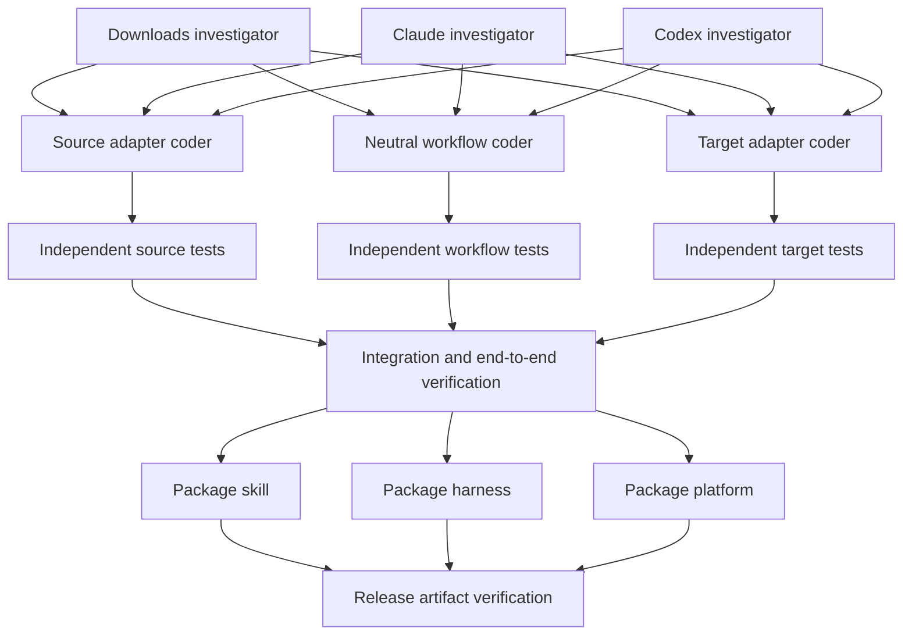

# Durable development orchestration

`switchit.orchestration` executes configured commands as a persisted DAG. It is a development control layer: investigators, coders, tests, integration, and packaging can run unattended once their executable wrappers and acceptance criteria are configured. It is separate from a captured user workflow's event/hierarchy graph.

The scheduler launches actual executable argv arrays. A role label does not call an AI model. Supply wrappers for the agent tools installed in your environment, their credentials through explicit environment forwarding, and the source directories they may inspect. No provider is contacted by the offline smoke example or test suite.

## Try a fully local graph

```sh
switchit orchestrate smoke-plan --workspace /tmp/switchit-workers --output /tmp/switchit-plan.json
switchit orchestrate run --plan /tmp/switchit-plan.json --output /tmp/switchit-run
switchit orchestrate status --output /tmp/switchit-run
switchit orchestrate run --plan /tmp/switchit-plan.json --output /tmp/switchit-run --resume
```

This creates two independent Python workers followed by a join. Each produces a JSON artifact; the join receives the two upstream artifact manifests. A completed resume verifies the stored artifact hashes and returns without repeating successful commands.

## Development graph



`generate_development_plan(workers, *, sources, include_publish=False, max_parallel=3, repairs=None)` generates this fourteen-task graph. The CLI accepts a worker file containing `workers`, `sources`, and optional `max_parallel` and `repairs`:

```json
{
  "sources": {
    "downloads": "/absolute/path/to/reviewed-downloads",
    "claude": "/absolute/path/to/reviewed-claude-traces",
    "codex": "/absolute/path/to/reviewed-codex-traces"
  },
  "max_parallel": 3,
  "workers": {
    "investigate_downloads": {
      "command": ["/absolute/path/to/configured-investigator-wrapper"],
      "cwd": "/absolute/path/to/downloads-investigation-workdir",
      "outputs": ["result.json"],
      "timeout_seconds": 300
    }
  }
}
```

The example shows one worker; configure all required roles before generating a plan:

| Stage | Required worker keys |
| --- | --- |
| Investigators | `investigate_downloads`, `investigate_claude`, `investigate_codex` |
| Coders | `code_source`, `code_workflow`, `code_target` |
| Independent module checks | `test_source`, `test_workflow`, `test_target` |
| Integration | `verify_integration` |
| Packaging | `package_skill`, `package_harness`, `package_platform` |
| Release checks | `verify_release` |

```sh
switchit orchestrate plan --workers /absolute/workers.json --output /absolute/plan.json
switchit orchestrate run --plan /absolute/plan.json --output /absolute/run
```

Each role needs an existing absolute working directory and executable command. The default declared output is `result.json`. Plan generation does not create agent wrappers, worktrees, or invoke agents. The integration wrapper must explicitly integrate the tested revisions and check the resulting revision. Packaging wrappers must consume that accepted revision. Distinct working directories permit parallelism; the scheduler serializes tasks sharing the same resolved directory to avoid obvious simultaneous editing collisions.

The generated CLI plan stops at verified release artifacts. The Python generator supports an explicitly configured `publish` worker only when `include_publish=True`; generating that node does not itself grant publication authorization.

## Task contract

A hand-written plan uses the same execution engine:

```json
{
  "plan_version": 1,
  "name": "Build and check an adapter",
  "max_parallel": 3,
  "max_run_seconds": 1800,
  "tasks": [
    {
      "id": "adapter",
      "command": ["/absolute/worker", "--mode", "adapter"],
      "cwd": "/absolute/adapter-worktree",
      "depends_on": [],
      "max_attempts": 2,
      "timeout_seconds": 300,
      "outputs": ["result.json"],
      "output_limit_bytes": 4000000,
      "pass_env": ["REQUIRED_PROVIDER_API_KEY"],
      "env": {"WORKER_MODE": "local"},
      "input": {"objective": "Implement the reviewed adapter contract"}
    }
  ]
}
```

Commands execute with `shell=False`. The environment contains a minimal system `PATH`, the named `pass_env` values, explicit `env` values, and three coordinator variables. Use absolute executable paths, or explicitly forward `PATH` if required. Credentials are never automatically inherited. Avoid placing credentials directly in `env`: the plan is persisted as JSON.

The wrapper reads a JSON request on stdin or from `$SWITCHIT_TASK_INPUT`:

```json
{
  "task_id": "adapter",
  "attempt": 1,
  "run_root": "/absolute/run",
  "input": {"objective": "Implement the reviewed adapter contract"},
  "previous_attempt": null,
  "dependencies": {}
}
```

On subsequent attempts `previous_attempt` contains the preceding result, exit code, and log receipts. Dependencies map task IDs to accepted artifact manifests with paths relative to `run_root`, SHA-256 hashes, sizes, and `log`/`output` kinds. `$SWITCHIT_RUN_ROOT` and `$SWITCHIT_TASK_ID` are also set. Wrappers should read the copied upstream artifacts, verify relevant revision identities, and produce the declared result files. Exit zero plus present declared outputs passes a command node. Domain-specific acceptance belongs in the configured verifier; the scheduler cannot infer correctness from prose.

## Bounded coder → verifier → repair loop

`run_repair_loop(config, root)` alternates a coder command with a separate fixed verifier. A failed verifier receipt becomes the next coder's `input.previous_verification`, including exit status and log paths. `input.request` carries the configured role input. The verifier receives `input.coder_receipt`. Every round uses the command scheduler and records separate coder/verifier evidence.

```json
{
  "repair_version": 1,
  "max_rounds": 3,
  "max_run_seconds": 900,
  "criteria_paths": ["/absolute/checks/acceptance.json", "/absolute/checks/test_adapter.py"],
  "coder": {
    "command": ["/absolute/configured-coder-wrapper"],
    "cwd": "/absolute/adapter-worktree",
    "timeout_seconds": 180,
    "input": {"objective": "Make the adapter satisfy the fixed acceptance suite"}
  },
  "verifier": {
    "command": ["/absolute/python", "/absolute/checks/test_adapter.py"],
    "cwd": "/absolute/adapter-worktree",
    "timeout_seconds": 60
  }
}
```

```sh
switchit orchestrate repair --config /absolute/repair.json --output /absolute/repair-run
switchit orchestrate repair --config /absolute/repair.json --output /absolute/repair-run --resume
switchit orchestrate cancel --output /absolute/repair-run
```

Criteria files and explicit verifier executable/script files in argv are hashed before execution and checked before/after every phase. The verifier argv and configuration are immutable. Changing a pinned file terminates the loop as failed. Include imported check modules, fixtures, and executable dependencies in `criteria_paths` when they affect acceptance; automatic import discovery is not provided. These checks detect persistent changes, not adversarial transient modification under the same OS user. An external immutable verifier environment is needed for that stronger boundary.

Success stops the loop immediately. Coder errors and verifier failures consume rounds; exhaustion stops as failed. Cancellation preserves the current phase for explicit resume. Interrupted/cancelled command attempts do not consume their failure retry allowance. Normal elapsed budgets accumulate across resumes. A terminal failed loop needs a new run directory and revised configuration to start another budget.

To enable actual repair lanes in the generated development graph, add this optional field to the worker configuration:

```json
{
  "repairs": {
    "source": {
      "criteria_paths": ["/absolute/checks/source-acceptance.json", "/absolute/checks/test_source.py"],
      "max_rounds": 3,
      "max_run_seconds": 900
    }
  }
}
```

The keys are `source`, `workflow`, and `target`. Each enabled lane runs its configured `code_*` and `test_*` commands through the bounded repair controller before the separate downstream test gate. Upstream investigation manifests are forwarded in the coder's `input.request.dependencies`, with their parent `run_root`. The controller derives a persistent nested run directory at `repairs/<task-id>` and emits `repair-result.json` with its round evidence. No separate repair config files are needed. Verifier scripts must accept the repair request shape when used within a lane and the ordinary task request shape at the downstream gate. The outer wrapper uses the generating interpreter and package location, so regenerate plans when moving installations.

Without `repairs`, the generated graph runs ordinary coder and verifier nodes and stops downstream progression when a verifier fails. It does not claim to repair by itself.

For a separately configured repair loop inside any hand-written DAG node, use this command:

```json
["/absolute/python", "-m", "switchit.orchestration.repair", "--config", "/absolute/repair.json", "--root", "/absolute/repair-run"]
```

Use an interpreter where SwitchIt is installed. This executable module forwards termination into its child scheduler cleanup. A task-specific wrapper can also call the Python API and map incoming dependency evidence into its initial repair configuration. The optional generated repair lanes provide this dependency bridge. The scheduler never repeats upstream graph nodes automatically: ordinary `max_attempts` repeats only the failed command; the repair controller supplies the coder/verification alternation.

## State, cancellation, and evidence

`status(root)` reads the latest atomic `state.json` snapshot; `cancel(root)` writes a cancellation request for the coordinator to observe. The CLI exposes both. A file lock permits one coordinator per run directory. Plans are immutable within a run root; changed commands/dependencies/configurations require a new root.

Each DAG attempt has `input.json`, `stdout.log`, `stderr.log`, `result.json`, and copied declared output files under `tasks/<id>/attempt-NNNN/`. State records attempts, timing, PIDs, errors, and SHA-256 receipts. Repair roots additionally contain `repair-plan.json`, pinned criteria digests, round feedback, and nested coder/verifier run roots. Failed tasks block dependent nodes; independent branches still finish. Logs remain local and may contain source or credential data printed by wrappers; they are not automatically redacted.

Normal cancellation and keyboard interruption terminate owned process groups on POSIX and persist interrupted evidence. Windows termination covers the direct process. Abrupt coordinator death can leave a worker alive: resume refuses to launch a duplicate while the recorded PID may still be running. An unknown launch outcome also requires manual reconciliation; the scheduler never kills a PID merely because it was recovered from disk. Successful artifact hashes are rechecked on resume.

This is a local coordinator, not a distributed queue or an OS sandbox. Absolute working directories do not prevent wrappers from accessing other files. It does not automatically create/merge worktrees, freeze the full toolchain, validate generated code semantics, or make arbitrary external side effects idempotent. Declared output files may preexist; wrappers must ensure their receipt identifies the current revision. Output limits are checked periodically, so they are a soft disk guard rather than a hard quota. Restarts after abrupt death can lose elapsed time since the last persisted checkpoint; a separate external deadline is needed for a strict wall-clock lifetime across machine failures.

## Validation

```sh
python3 -m unittest tests.test_orchestration
```

The offline suite covers dependency joins, true overlap and bounded concurrency, shared-directory serialization, failure isolation, retries and feedback, time/output limits, immutable plans and artifacts, interruption cleanup, single-coordinator locking, cancellation/resume, successful second-round repair, fixed criteria/script tamper rejection, repair round exhaustion, and an entire generated development graph whose source lane repairs on its second round before integration and packaging.
