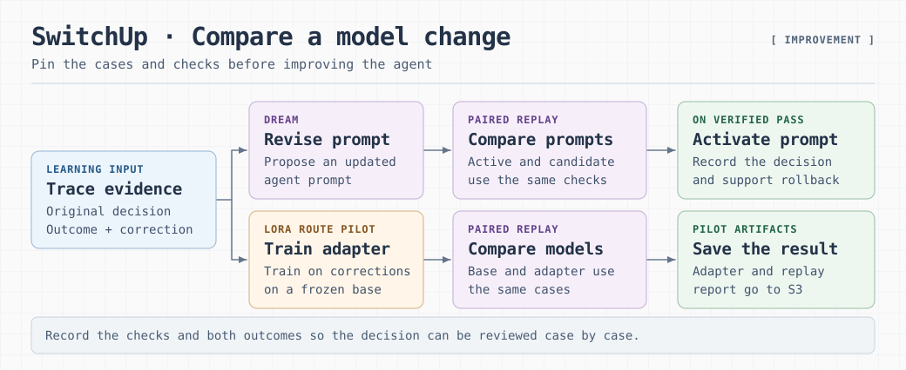

# SwitchUp

SwitchUp is Sova-Kit's improvement module. Start with a reviewed correction, then compare the active and proposed behavior on the same cases. An instruction change becomes eligible for activation after it repairs an observed failure and passes every required check. [SwitchUp guide](docs/switchup.md)

[Connected runtime architecture](docs/switchup-architecture.svg)

## Use cases

- **Make a support agent ask for approval.** Use the original cancellation trace to explain the error. Replay the active and proposed instructions on confirmed and unconfirmed requests. Check the agent's decision and the resulting order state. [Replay guide](docs/switchup.md#replay-tool-effects)
- **Evaluate a weight update.** Use reviewed correction examples to train a small adapter on a frozen checkpoint. Compare the base model and adapter on fixed cases and review the per-case results. The prepared LoRA pilot packages this comparison for SageMaker and saves the adapter and report to S3 when run. [LoRA Route](LoRA-Route/README.md)

## Inside SwitchUp

| Folder | Files and responsibility |
| --- | --- |
| [Loop](Loop/) | Project state, CLI handlers, review rounds, and release history |
| [Dream](Dream/) | Proposes instruction changes from evidence and compares them with the active version |
| [Retraining](Retraining/) | The worker that trains a LoRA adapter and compares its results with the base model |
| [LoRA Route](LoRA-Route/README.md) | SageMaker bundle preparation and S3 artifacts for the weights pilot |

SwitchIt collects traces into `Sova-Kit-data/traces/`. The task state tracks the work to turn them into verified corrections and fresh evaluation cases. Live adapter serving is pending. [Traces](../SwitchIt/Traces/README.md) · [Python API](../SwitchIt/docs/python-modules.md) · [Task state](TASK_STATE.md)
