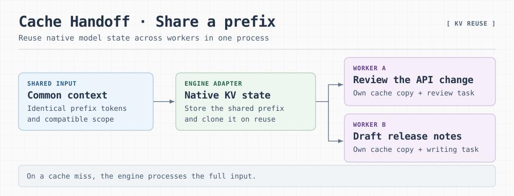

# SOVA Cache Handoff

Cache Handoff is Sova-Kit's module for reusing shared model context. Workers using the same model can reuse KV state for an identical starting sequence of tokens. Share chat history, source files, or tool results, then append a worker-specific task. Each worker gets an independent cache copy. An uncached request starts from position zero.



## Use case

**Give two workers the same release context.** Prime the cache with the repository context and relevant tool results. Ask one worker to review an API change and the other to draft release notes. When their scope and leading tokens match, each worker starts from its own copy of the shared KV state and processes the remaining tokens.

## Try the demo

This developer preview runs inside one Python process and needs a model engine that accepts KV state. The offline demo works with Python 3.10+ and uses synthetic state. Run these commands from the Sova-Kit root.

```sh
python -m pip install ./sova-cache-handoff
python -m sova_cache_handoff.demo
```

## Integrate with your engine

```python
from sova_cache_handoff import CacheHandoff, CacheScope, NativePrefixRegistry

registry = NativePrefixRegistry(engine.clone_cache, max_bytes=64 * 1024 * 1024,
                                ttl_seconds=300)
handoff = CacheHandoff(registry, engine.advance, engine.cache_bytes)
scope = CacheScope(tenant_id, checkpoint_id, tokenizer_id, layout_id)

handoff.prime(scope, shared_tokens)
result = handoff.run(scope, shared_tokens, worker_tokens)
```

The engine and token arrays in this example come from your application. See `sova_cache_handoff/demo.py` for a complete runnable example. Render and tokenize each full prompt before splitting it. Build the scope from the authenticated tenant, checkpoint revision, tokenizer, and cache layout including dtype. The shared prefix must match the exact starting tokens.

| Interface | Contract |
| --- | --- |
| `engine.advance(scope, tokens, cache)` | Returns `(output, updated_cache)`. `cache=None` starts at zero. A cache exposes `get_seq_length()`. |
| `engine.clone_cache(state)` | Returns an independent writable copy. |
| `engine.cache_bytes(state)` | Returns retained bytes as an integer. |
| `handoff.remember(scope, prefix, state)` | Saves native prefix state already produced by your engine. Returns whether it was retained. |
| `handoff.run(scope, prefix, suffix)` | Sends the uncached tokens to the engine and returns `output`, `reused_tokens`, and `processed_tokens`. The suffix must have at least one token. |

The lightweight registry uses bounded, expiring native caches in one process.

## Run Cache Handoff with vLLM

The research project in this module includes a vLLM 0.34.0 connector for exporting native KV blocks and loading a prepared prefix into a receiver. It supports a same-checkpoint control and an experimental Qwen3 mapper path. The CPU tests pass. Live GPU validation is pending.

[vLLM developer guide](kv-cache-transfer/VLLM_HANDOFF.md) · [Connector code](kv-cache-transfer/kvverify/vllm_connector.py)

[API diagram](sova-cache-handoff-devx.svg)
