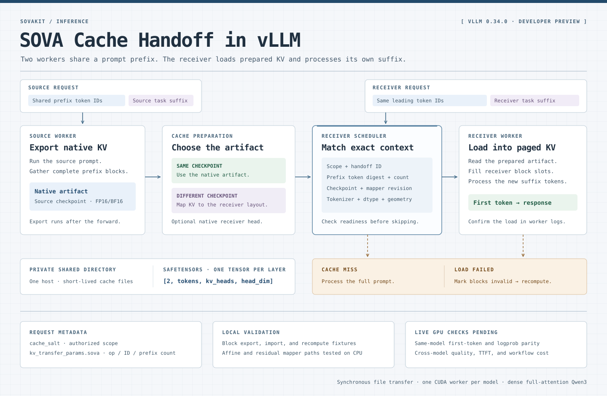

# SOVA Cache Handoff for vLLM

Run one shared prefix through a source model, then reuse its KV state when a receiver handles a follow-up. The connector exports native KV blocks, the mapper prepares blocks in the receiver's layout when the models differ, and vLLM loads the prepared prefix before processing the receiver's suffix.

**Status.** The connector and mapper bridge passed the local CPU suite. The two-worker GPU identity check and live quality and latency benchmarks are pending. The first implementation targets vLLM 0.34.0, dense full-attention Qwen3 models, matching tokenizers, and FP16 or BF16 KV. Each model runs with one CUDA worker on the same host. [vLLM connector interface](https://github.com/vllm-project/vllm/blob/v0.34.0/vllm/distributed/kv_transfer/kv_connector/v1/base.py)

## How a handoff works

The source exports a prefix once the scheduled forward has computed all its blocks. With the same checkpoint on both workers, the receiver can load that native artifact directly. Across checkpoints, `VllmCacheMapper.prepare()` reads the source artifact and writes a separate receiver artifact. It can splice in an already computed native receiver head, such as the 256-token head used in our earlier Qwen3 experiments.

The receiver checks compatibility before telling vLLM to skip tokens. If a selected artifact disappears or fails validation later, the worker reports invalid blocks to vLLM. With `kv_load_failure_policy="recompute"`, vLLM discards the affected step and recomputes the prefix. The receiver's automatic prefix cache is disabled for this prototype so translated state stays out of its native cache pool.

## Request and artifact contract

Requests go through `POST /v1/completions` with actual `prompt` token IDs. Set `add_special_tokens` to `false`. The caller renders and tokenizes both complete prompts, then selects the same leading tokens in both. The worker-specific instructions come after that boundary.

| Field | Type | Meaning |
| --- | --- | --- |
| `prompt` | `list[int]` | Full input, including at least one token after the shared prefix |
| `cache_salt` | `str` | Authorized scope set by the gateway and matched to the server configuration |
| `kv_transfer_params.sova.op` | `"export"` or `"load"` | Export from the source or load on the receiver |
| `kv_transfer_params.sova.id` | `str` | Caller-generated handoff ID shared by the two requests |
| `kv_transfer_params.sova.prefix_tokens` | `int` | Positive count divisible by the engine block size. Default server cap is 8,192 tokens. |

The artifact binds scope, handoff ID, exact prefix token digest and count, checkpoint, tokenizer, and mapper revision. Each layer is stored in Safetensors with shape `[2, tokens, kv_heads, head_dim]`. The leading axis holds keys and values. The connector gathers and scatters those tensors using the server's own allocated block IDs. A native artifact has an empty mapper digest. The receiver's configured `mapper_sha256` selects the mapped namespace for cross-model requests.

Use a private directory owned by the serving user. The files hold model state derived from the prompt. The default 15-minute TTL limits reuse eligibility. Disk cleanup is handled by the operator. For a local pilot, use loopback endpoints and a unique directory. For a gateway, derive the scope and handoff metadata from the authenticated request.

## Run the same-model control

This is the first GPU check. Use two workers serving the same immutable checkpoint and compare a confirmed native import against full prefill.

### 1. Set up the environments

From the `kv-cache-transfer/` folder on a Linux CUDA host, choose a local snapshot directory. The serving and mapper environments are separate because the mapper uses the project's pinned Transformers version.

~~~sh
export SOVA_CODE_DIR="$(pwd -P)"
export SOVA_RUN_DIR="$(mktemp -d)"
export SOVA_SOURCE_MODEL_DIR="/models/qwen3-source"
export SOVA_TARGET_MODEL_DIR="$SOVA_SOURCE_MODEL_DIR"
export SOVA_SCOPE="sova-identity"

mkdir -m 700 "$SOVA_RUN_DIR/kv"
python3.11 -m venv "$SOVA_RUN_DIR/serve"
python3.11 -m venv "$SOVA_RUN_DIR/map"
"$SOVA_RUN_DIR/serve/bin/python" -m pip install '.[vllm]'
"$SOVA_RUN_DIR/map/bin/python" -m pip install '.[hf]'
~~~

### 2. Generate the worker configs

~~~sh
"$SOVA_RUN_DIR/map/bin/python" - <<'PY'
import json
import os
from pathlib import Path

from kvverify.vllm_map import Checkpoint

run = Path(os.environ["SOVA_RUN_DIR"])
scope = os.environ["SOVA_SCOPE"]
checkpoint = Checkpoint.from_local(os.environ["SOVA_SOURCE_MODEL_DIR"], "bfloat16")
for name, role in (("source", "kv_producer"), ("target", "kv_consumer")):
    config = checkpoint.connector_config(run / "kv", scope, role=role)
    (run / f"{name}.json").write_text(json.dumps(config, indent=2) + "\n")
PY
~~~

### 3. Start the servers

Run both commands from the setup shell so they inherit its paths. The example assigns device 0 to the source and device 1 to the receiver. Keep the same shell open for the client.

~~~sh
CUDA_VISIBLE_DEVICES=0 "$SOVA_RUN_DIR/serve/bin/vllm" serve "$SOVA_SOURCE_MODEL_DIR" \
  --served-model-name source --port 8000 --host 127.0.0.1 \
  --dtype bfloat16 --block-size 16 --attention-backend FLASH_ATTN \
  --enforce-eager --no-async-scheduling --no-enable-prefix-caching \
  --kv-transfer-config "$(cat "$SOVA_RUN_DIR/source.json")" \
  >"$SOVA_RUN_DIR/source.log" 2>&1 &
SOVA_SOURCE_PID=$!
~~~

~~~sh
CUDA_VISIBLE_DEVICES=1 "$SOVA_RUN_DIR/serve/bin/vllm" serve "$SOVA_TARGET_MODEL_DIR" \
  --served-model-name target --port 8001 --host 127.0.0.1 \
  --dtype bfloat16 --block-size 16 --attention-backend FLASH_ATTN \
  --enforce-eager --no-async-scheduling --no-enable-prefix-caching \
  --kv-transfer-config "$(cat "$SOVA_RUN_DIR/target.json")" \
  >"$SOVA_RUN_DIR/target.log" 2>&1 &
SOVA_TARGET_PID=$!
~~~

Check both endpoints before running the client. Startup may take a few minutes.

~~~sh
curl -fsS http://127.0.0.1:8000/health
curl -fsS http://127.0.0.1:8001/health
~~~

### 4. Compare cached and cold requests

Run this from `$SOVA_CODE_DIR`. The example tokenizes a whole prompt for each worker, finds the identical leading tokens, and rounds down to complete 16-token blocks.

~~~sh
cd "$SOVA_CODE_DIR"
"$SOVA_RUN_DIR/map/bin/python" - <<'PY'
import json
import os
from pathlib import Path

from transformers import AutoTokenizer

from examples.vllm_handoff import Endpoint, compare

tokenizer = AutoTokenizer.from_pretrained(
    os.environ["SOVA_SOURCE_MODEL_DIR"], local_files_only=True, trust_remote_code=False,
)
run = Path(os.environ["SOVA_RUN_DIR"])
scope = os.environ["SOVA_SCOPE"]
context = "Release context\n" + "The deployment passed checks and the API is healthy.\n" * 64
source_ids = tokenizer.encode(context + "\nTask: summarize this release.", add_special_tokens=False)
target_ids = tokenizer.encode(context + "\nTask: list the verification steps.", add_special_tokens=False)
shared = 0
for left, right in zip(source_ids, target_ids):
    if left != right:
        break
    shared += 1
count = min(shared, len(source_ids) - 1, len(target_ids) - 1) // 16 * 16
assert count > 0, "Need a shared block and at least one token in both suffixes"
prefix = source_ids[:count]
source_suffix = source_ids[count:]
target_suffix = target_ids[count:]
source = Endpoint("http://127.0.0.1:8000/v1", "source")
target = Endpoint("http://127.0.0.1:8001/v1", "target")

report = compare(source, target, run / "kv", scope, prefix, source_suffix, target_suffix)
print(json.dumps(report, indent=2))
PY
~~~

Check `"$SOVA_RUN_DIR/target.log"` for `SOVA loaded N external KV tokens` on the load request. Compare `handoff` and `native` for the same first token and numerically close log probabilities. For a miss control, send a prompt with one changed prefix token using the same `handoff_id` and verify that the receiver completes normally without a cache hit.

## Run a cross-model handoff

Use the exact source and target checkpoint directories that the directional mapper was trained on. The tested research recipe uses a Qwen3 1.7B source, a Qwen3 8B receiver, an all-head affine bundle, an optional multi-donor residual, and a 256-token native receiver head. Every mapper bundle needs its original `manifest.json` and `weights.safetensors`.

In the mapper environment, set `SOVA_SOURCE_MODEL_DIR` and `SOVA_TARGET_MODEL_DIR` to the matching model snapshots. Set `SOVA_AFFINE_DIR` and, when using the residual, `SOVA_RESIDUAL_DIR` to the matching bundles. Generate new configs with this block. Use a fresh scope for the cross-model run.

~~~python
import json
import os
from pathlib import Path

from kvverify.vllm_map import Checkpoint, VllmCacheMapper

run = Path(os.environ["SOVA_RUN_DIR"])
scope = os.environ["SOVA_SCOPE"]
source_checkpoint = Checkpoint.from_local(os.environ["SOVA_SOURCE_MODEL_DIR"], "bfloat16")
target_checkpoint = Checkpoint.from_local(os.environ["SOVA_TARGET_MODEL_DIR"], "bfloat16")
residual = os.environ.get("SOVA_RESIDUAL_DIR")
mapper = VllmCacheMapper(source_checkpoint, target_checkpoint, os.environ["SOVA_AFFINE_DIR"],
                         residual_dir=residual, native_head_tokens=256 if residual else 0)
source_config = source_checkpoint.connector_config(run / "kv", scope, role="kv_producer")
target_config = target_checkpoint.connector_config(
    run / "kv", scope, role="kv_both" if mapper.native_head_tokens else "kv_consumer",
    mapper_sha256=mapper.sha256,
)
for name, config in (("source", source_config), ("target", target_config)):
    (run / f"{name}.json").write_text(json.dumps(config, indent=2) + "\n")
~~~

Stop the identity workers with `kill "$SOVA_SOURCE_PID" "$SOVA_TARGET_PID"` from the setup shell. Use the same commands to start the new workers with their respective model directories and configs. In the comparison script, build `mapper` from the same checkpoint paths, bundles, and native-head setting, then pass `mapper=mapper` to `compare()`. The shared prefix must extend beyond the native head. The client exports the source prefix and optional native receiver head, prepares the mapped artifact, and sends the receiver's load request. The `preparation_ms` field includes the export requests and mapper preparation. Target `ttft_ms` starts at the receiver request.

## Verify changes and measure them

| Check | Evidence to collect |
| --- | --- |
| Local connector | Chunked export, different destination block IDs, exact prefix and scope checks, and invalid blocks reported on a failed load |
| Local mapper | Target geometry and preservation of the optional native receiver head for both affine and residual paths |
| Live identity | Receiver log confirms the expected hit. Cached and native outputs agree for the same model and prompt. |
| Live cross-model | Score the same held-out agent tasks with normal prefill, native prefix caching, and mapped handoff. Record the fraction of eligible requests that actually hit. |

The local suite passed 257 tests, including the connector lifecycle with a vLLM interface double and the mapper on tiny CPU tensors. From the mapper environment, run the targeted tests offline.

~~~sh
KVVERIFY_TORCH_SMOKE=1 HF_HUB_OFFLINE=1 TRANSFORMERS_OFFLINE=1 \
  "$SOVA_RUN_DIR/map/bin/python" -m unittest discover -s tests -p test_vllm_handoff.py -v
~~~

The earlier 32-question PyTorch run on an L40S measured 324 ms median TTFT with a warm source cache and 10/32 correct for the fast mapper. Native 8B scored 13/32 with 2,147 ms cold and 99 ms with its own cache warm. Use those as research evidence for the next benchmark. The vLLM comparison should measure target TTFT, full workflow time including cache preparation, peak memory, task success, and GPU-seconds per completed task. [Earlier PyTorch results](reports/mapper-accuracy-l40s-v1/result.json)

## Code map

| File | Role |
| --- | --- |
| [kvverify/vllm_connector.py](kvverify/vllm_connector.py) | vLLM V1 scheduling and paged-cache hooks |
| [kvverify/vllm_handoff.py](kvverify/vllm_handoff.py) | Cache identities, Safetensors storage, and block gather and scatter |
| [kvverify/vllm_map.py](kvverify/vllm_map.py) | Checkpoint validation and preparation of receiver cache artifacts |
| [examples/vllm_handoff.py](examples/vllm_handoff.py) | Two-worker client and timing example |
| [tests/test_vllm_handoff.py](tests/test_vllm_handoff.py) | Offline connector and mapper tests |
