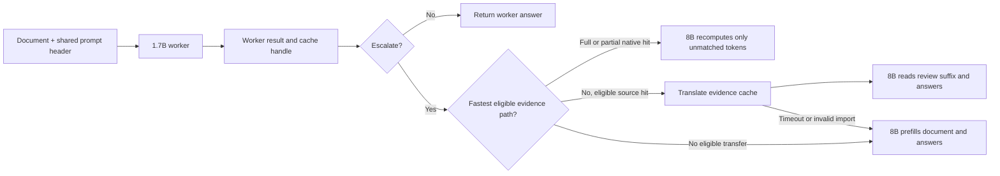

# SOVA agent escalation through cross-model cache transfer

## Execution checkpoint · 22 November 2026

The active pair is Qwen3 1.7B → 8B on one GPU. On 13 selected LongBench questions the native 8B answered correctly, the trained mapper recovered eight answers and both the affine and zero-residual controls recovered four. Three of the six questions missed by all earlier cheaper paths were recovered. The trained mapper took 1,027 ms median for mapping alone. The optimized implementation matched sampled outputs on synthetic Mac GPU caches and reduced the 8,193-token mapping time from 1,362 to 936 ms. The optimized L40S replay is packaged. [GPU replay](../reports/mapper-ablation-v1/result.json) · [Replay package](../reports/mapper-fast-package-check-v1/submission.json)

1. **Verify the speed fix on the L40S.** Run the packaged `--with-fast` replay on the same 13 documents with the original trained mapper and the same weights, prompts, hardware and precision. Require identical option decisions across all paired repeats and at least 25% lower median mapping time compared with the reference measured in that run. Record option-logit drift, mapper and total first-token time, and per-document timings. If decisions change, trace the numerical difference. If the speed gain falls short, profile donor preparation, projections and output assembly. Use the existing checkpoint for both follow-ups.
2. **Check that the quality gain travels.** Freeze the optimized code and weights, then score all nine documents in the reserved LongBench panel. Replay native 8B cold, a native 8B cache hit, small-model-only, native excerpts and both transfer implementations on the same questions. Count changes in both directions, unique correct answers beyond the cheaper routes, and errors. Use this small panel as a replication screen. Before a product-quality claim, freeze a larger document-disjoint escalation set sized from paired disagreement rates and apply the predeclared −3 percentage-point margin with a one-sided 95% confidence bound. Keep a separate acceptance set if the mapper changes after the nine-document screen. [Reserved panel](../datasets/longbench-v2-readout-unseen-v1/manifest.json)
3. **Test one real escalation workflow.** Once quality qualifies, wire one small worker to one 8B reviewer using an exact shared prefix. Reuse a valid native 8B cache first. Where the target misses, compare eligible transfer and native re-prefill using a policy driven by request-time signals. Include rejected transfers, fallbacks and their costs. Require at least 20% lower median escalation time to first token on target-cache misses, comparable or better p95, and lower cost per accepted answer against the strongest quality-qualified route. Report how often transfer actually runs, peak memory and cache bytes. Charge the small model's reading time whenever it was extra work for that request.

The L40S speed replay passed. Median mapping time fell from 1,044 to 177 ms and median time to first token from an existing source cache fell from 1,191 to 325 ms. All 13 answer choices matched across both repeats. Both trained implementations scored 8/13 and the original single-donor control scored 4/13 at 415 ms to first token. The largest option-logit change was 0.25. The replay cost about $0.32 under the one-run $30.31 allowance. The nine-document replication is packaged with the same mapper code and weights and a 650-second limit. It requires separate compute authorization. [Speed replay](../reports/mapper-fast-l40s-v1/result.json) · [Reserved replication package](../reports/mapper-reserved-package-check-v1/submission.json) · [Compute ledger](autonomous-loop/ledger.json)

### Accuracy experiment

An answer-only join on the 13 selected development questions found that older cheap routes and the fast mapper together covered 11. The fast mapper answered two questions that the small model, 256-token native prefix, native excerpts and single-donor transfer all missed. Three of the fast mapper's five misses were answered by those cheap routes. An older 4B → 8B checkpoint answered one additional miss. These separate runs show complementary errors. The 11/13 count assumes advance knowledge of the correct answers, and the timing samples came from different workers. [Fast mapper rows](../reports/mapper-fast-l40s-v1/rows.json) · [Earlier excerpts rows](../reports/session-evidence-replay-fixed-v1/rows.json) · [4B development rows](../reports/session-4b-readout-v1/development-rows.json)

The next accuracy screen compares the frozen fast mapper with the same mapper plus up to four short excerpts read directly by the 8B model. Excerpt selection uses the question and all visible options. Run it on all 32 development documents, alongside the 1.7B alone, 8B with excerpts alone, single-donor transfer and full native 8B. Check that the combination gains more correct answers than it loses and recovers at least one native-correct answer missed by every cheaper target-cache-miss route. Charge excerpt selection and the added 8B input in the first-token timing. The offline tokenizer check verified every shared-prefix boundary. The nine reserved documents remain outside this screen. [Accuracy replay package](../reports/mapper-accuracy-package-check-v1/submission.json)

If the combination fails, profile which evidence the mapper lost before training again. The current checkpoint used 64 documents with 2,431–8,314-token prompts. Try training on longer, evidence-dependent prompts with supervision at the answer decision and a matched-length development control. Use the 4B donor and the native reread as separate controls. [Training audit](autonomous-loop/ANSWER_CONTINUATION_PILOT.md)

The L40S accuracy replay finished all 32 questions. The fast mapper scored 10/32 at 324 ms median first-token time with an existing source cache. Adding excerpts scored 11/32 at 608 ms, fixing three answers and losing two. Excerpts alone also scored 11/32 at 152 ms. On the original native-correct 13, the combined route scored 9/13 from an 8/13 baseline, recovering two and losing one. Both recoveries were also correct on excerpts alone. The run cost an estimated $0.50. [Accuracy replay](../reports/mapper-accuracy-l40s-v1/result.json)

An offline follow-up averaged the two repeats' option logits for each route, normalized each route over the four choices, and equally averaged the fast-only and fast-plus-excerpts probabilities. It scored 10/13 on the selected subset, preserving the earlier eight, and 13/32 overall. No additional inference ran. The two paths can share a translated prefix because all 32 excerpt prompts passed the exact prefix check without cropping. Measure both branches from one translated prefix and confirm on fresh documents before adopting this strategy. [Saved option logits](../reports/mapper-accuracy-l40s-v1/rows.json)

The next replay is packaged. It measures fast-only scoring against two suffixes on one translated cache, under the original and option-balanced excerpt selectors. The balanced selector gives each option its own normalized retrieval query. It uses visible option text and excludes the gold label. The local branch-parity test matched independently translated logits exactly and verified one mapper call. The archive's original excerpts reproduced on all 32 documents, and the balanced selector changed 30 selections. The 600-second L40S replay caps estimated compute at $0.47 and would bring the estimated total including reserve to $31.20. The 11/13 gate tracks the eight archived wins individually. [Shared-cache replay package](../reports/mapper-shared-cache-package-check-v2/submission.json)

## Modules

| Module | Job | First deliverable |
|---|---|---|
| 1. Evaluation and replay | Compare identical tasks across worker-only, native and transfer paths | A grouped dataset, fixed escalation trace, and an accuracy, latency and cost report |
| 2. Worker and orchestrator | The 1.7B worker reads evidence and attempts the task. The 8B orchestrator handles selected escalations | One worker, one orchestrator, one long document and a single escalation |
| 3. Escalation policy | Choose worker answer, target cache hit, transfer, or native re-prefill | Deterministic rules driven by cache availability, supported inputs and a measured latency estimate |
| 4. Shared evidence prefix | Define the exact immutable token prefix that carries the document | A versioned prompt renderer and a test that worker and orchestrator prefill identical token IDs and positions |
| 5. Cache registry | Track identity, origin, availability, lifetime, and memory | Process-local storage with byte limits and typed handles for source, translated target and native target caches |
| 6. Adapter and training | Convert source K/V into usable target K/V | A fixed affine control and one small rank-limited candidate trained on the frozen 8B model’s answer behavior |
| 7. Receiver and timing | Import target-format state, prefill the new suffix and produce the answer | The existing Hugging Face runtime, with native identity checks and timing for each stage |
| 8. Native fallback | Return the original 8B path if transfer is unavailable or the request is outside its qualified scope | Native target cache reuse or full prefill. Record the reason, time and cost of every fallback |

Reuse `kvverify/hf_backend.py` for the first model pair, `kvverify/affine_cache.py` for the baseline, `kvverify/qa_training.py` for functional training, and `kvverify/transfer_economics.py` for timing. Add orchestration and cache identity around those components.

## Workload and design

A small model reads a document during work the customer already needed. When its answer requires review, the big model reads the review instructions and answers with the document in context. Transfer has an opportunity only when the exact source evidence prefix is still cached and the target’s native evidence prefix misses. The first prototype runs on one GPU with both models resident.

The prefix ends after the evidence, before either agent’s private instructions, tools, question, output, or chain of messages. On escalation, the 8B model processes the actual review prompt and any worker summary supplied as visible text. Distinct documents use separate requests or an explicit native composition step. KV entries from independent histories cannot be combined into a valid joint attention context by concatenating them.

Each registry handle includes the tenant or authorization scope, document version, hash of exact prefix token IDs, token count and positions, tokenizer identity, source and target checkpoint revisions, precision and layout, adapter revision, and state origin. Reject incompatible or stale entries. Keep translated and native target cache identities distinct. The local prototype needs bounded eviction and request ownership. Treat stored prefix tensors as immutable. Each branch gets independent writable suffix state through copy-on-write or an explicit clone of any mutable tensors. Test interleaved branches A/B/A and cancel B, then verify both A reads and every completed branch against independent native recomputation. A changed leading system prompt, tool definition, role order or token position makes the prefix ineligible unless the exact shared prefix is still present. Add persistent or networked cache storage after the same-GPU path earns it.

## Evidence and priorities

On the 267-question QuALITY slice, native 8B scored 73.0%, native 1.7B 52.4% and the affine translator 21.7%. Rebuilding the first 256 tokens raised translation to 44.6%, below the 46.8% native prefix-only control. Median model-only TTFT was 692 ms for native 8B cold, 920 ms for cold transfer, 748 ms with an existing source cache and 56 ms with a native target cache hit. These timings use one sample per article. Decode TPS and end-to-end orchestrator latency remain unmeasured. [QuALITY results](../reports/quality-8b-v1/RESULTS.md)

Median conversion alone took 692 ms, essentially the entire cold 8B budget. All 15 native full-versus-split checks matched the first token, but only nine passed the existing probability tolerance. Measure the native variability and decision agreement on the full development panel before using KL to compare candidates. [Raw timings](../reports/quality-8b-v1/collected/timings.json)

On the observed path, source-cache-hit transfer needs to remove about 56 ms just to equal cold 8B at the reported medians. On a cold source miss, the shortfall was about 228 ms. Use paired per-request timings for decisions. At the same precision and context length, the target still runs its normal decode, so judge transfer primarily by time to first token and total escalation latency.

## Build sequence and decision gates

1. **Replay a real escalation workload.** Choose one document review workflow with verified answers and clear evidence. Freeze worker inputs, escalation decisions and the target suffix before comparing branches. Capture independent documents and multiple questions per document. Count source hits, native target hits and misses, invalid prefixes, reader cache age, queue time, and bytes held. Replay worker-only, native target with longest authorized prefix reuse, a worker evidence/snippets handoff, and transfer. For partial native hits, prefill only the unmatched token IDs and measure their cost. Give each policy the same GPU memory budget and arrival trace. Include a document-swap control to verify the target actually uses the evidence. Use prior QuALITY results as development evidence and reserve new independent documents before training.
2. **Prove the handoff contract.** On a small fixed panel, compare native unsegmented 8B with the same 8B loaded from a native prefix cache. Measure the native A/A numerical floor at the intended precision before fixing the equivalence tolerance. Confirm identical token positions and semantic answers. Exercise cancellation, cache expiry, cross-tenant attempts, wrong-document state and invalid checkpoint identities. Confirm that a worker’s generated transcript is replayed as ordinary target suffix text, with the target tokenizer and role boundaries, when the task requires it. Freeze the trace and the semantic scoring rule before candidate results.
3. **Test one trained adapter.** Keep the 1.7B/8B checkpoints fixed. Compare the current affine baseline with a small joint K/V residual on top of it. Use document-disjoint training examples and frozen 8B answer-token distributions, giving most weight to query-dependent answer positions. Train against real escalation suffixes and complete prefixes. Use gold answers to measure held-out correctness, not to imitate incorrect target outputs blindly. Profile mapper compute and memory on a small panel in parallel with the quality work. If the candidate still trails the worker and the evidence/snippet baseline on development, stop kernel and serving work and report the gap.
4. **Qualify one frozen candidate.** Predeclare an absolute task quality floor and a noninferiority margin with a sample size based on paired disagreements and article clustering. A proposed starting margin is 3 percentage points versus native 8B on a context-dependent escalation workload. Require a one-sided 95% lower bound above −3 pp for a quality claim and audit important evidence failures separately. Use a fresh document-disjoint set. First score the frozen adapter directly on all frozen eligible escalations, before fallback, with errors counted as failures. Then score the routing policy on all requests with fallback time and final answers included. Predeclare minimum transfer activation among eligible escalations and minimum overall coverage from the trace before looking at candidate outcomes. Report both coverage figures and the always-native and evidence baselines. Small panels are engineering screens.
5. **Prove a speed and cost win.** On qualifying workloads, target at least 20% lower p50 escalation TTFT than native 8B on cold target misses and comparable or better p95 after including fallbacks. Measure p50/p95 from the same gateway boundary, and report whole-workflow latency, TPS after first token, GPU-seconds per accepted answer, cache hit rates, bytes, and cost with the same concurrency and residency budget. Compare against native 8B hits when available. Charge source prefill when it wasn't already useful work, including speculation that is discarded. Charge cache copies, layout packing, import and synchronization. In production, transfer must beat the strongest quality-qualified baseline on the measured workload mix. If the speed gate fails, profile conversion and optimize the largest measured component before repeating one bounded trial.
6. **Integrate serving after a single-GPU pass.** Export mapper weights and compatibility metadata. Test a target engine connector using native state first, then converted state. Re-run quality and latency under batching, eviction and concurrency before trying separate GPUs. Remote transport adds time and cache residency costs, so repeat the break-even measurement there.

The first implementation milestone is the one-worker replay with exact token identity and strong baselines. The first product milestone is a qualified acceleration on target misses that stays beneficial after counting native hits, ineligible requests and fallback. The plan itself launches no GPU job. Previous recorded compute is about $9.95. Reconcile actual spend and reserve worst-case runtime before each new job under the existing $50 threshold.

## Independent review and spend

**GPT-6.2 Astra is the reviewer.** The reviewer checks the exact-prefix contract and trace before the baseline run, the frozen data split and thresholds before training, and the raw paired results before any serving promotion. The implementation owner records each review and how the finding was addressed. A skipped or failed gate stays visible in the report.

Astra checked the original rows and timing records, then reviewed this draft. Its findings added the native numerical check, independent branch writes and cancellation tests, longest-prefix native reuse, and distinct adapter and policy quality gates with coverage requirements. Astra also identified that conversion alone already consumes the native cold TTFT budget.

| Stage | Proposed additional compute ceiling | Evidence required to move forward |
|---|---:|---|
| Trace and offline fixtures | $0 | Exact-prefix contract and observed opportunity frequency |
| Native baselines and protocol | $3 | Verified native reuse plus a context-sensitive task and timing baseline |
| One development candidate | $6 | Valuable quality on escalations and credible timing headroom |
| Independent confirmation | $10 | Frozen candidate and prospective quality and speed gates |

These ceilings total $19. With $9.95 recorded so far, the plan leaves about $21.05 below the user's $50 threshold, including the ledger's $5 reserve for extras. Reconcile live spend before allocation. Spending on each stage depends on passing the previous stage.

The [cache agent graph](cache-agent-graph.md) specifies the separate serving and engineering loops, node artifacts, retries, and the final success predicate.
