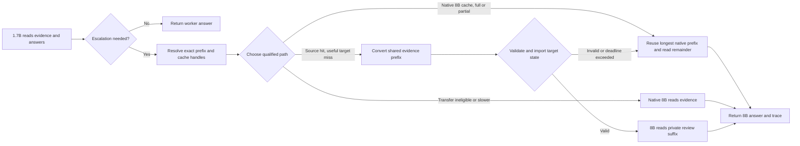
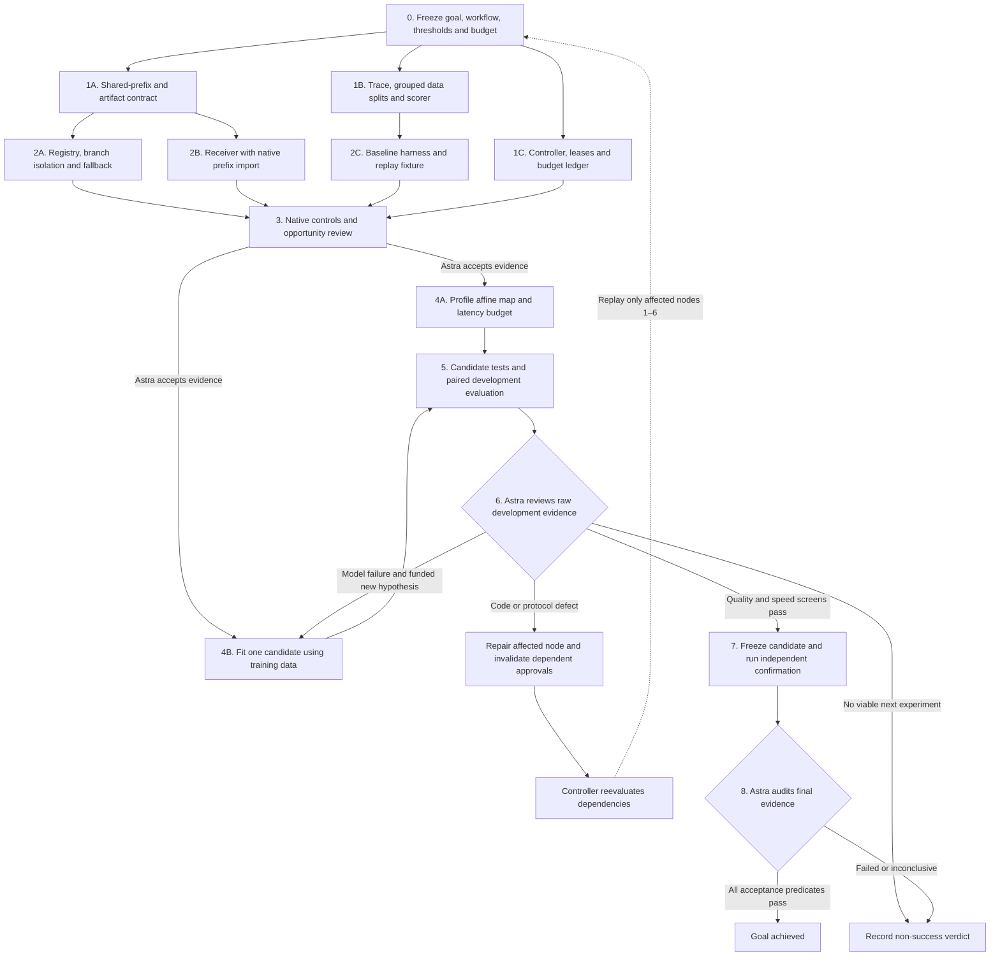

# SOVA cache agent graph

The runtime hands off one exact document prefix from Qwen3 1.7B to Qwen3 8B. A separate async engineering graph builds, tests, and reviews that runtime. It can retry a failed node or test a new adapter while keeping accepted artifacts and measurement rules intact.

The current baseline is 21.7% for full translation against 73.0% for native 8B on QuALITY. Conversion alone took 692 ms, about the same as native 8B's entire cold path. The graph has to disprove both limitations on a workload with a measurable handoff opportunity. A passing unit test, a completed training job, and a working demo have different meanings. [Measurements](../reports/quality-8b-v1/RESULTS.md)

## Runtime graph



Use one agreed leading prompt format and one immutable evidence prefix. The worker question, tool calls and review instructions live after that boundary. If an agent puts its private instructions before the evidence, that changes the token prefix and can make transfer ineligible. A worker transcript can be passed as text in the target's suffix where the workflow calls for it. Prefix reuse matches actual tokens and positions. It does not combine caches from unrelated conversations.

Cache handles bind authorization scope, exact token hash, positions, model revision, tokenizer, cache format and dtype. Translated handles also bind the source checkpoint, source prefix and mapper revision. The registry tracks ownership, bytes, expiry and eviction. Each reader appends to private suffix state. The fallback uses the longest authorized native prefix still available, including a zero-token miss, and shares the same request deadline and scoring rule. A late mapper result cannot race the chosen fallback into the answer or cache.

## Async engineering graph



The graph forks only after the goal and artifact contract are written. The controller, prefix contract and benchmark protocol can start together. Nodes 2A, 2B and 2C proceed once their respective inputs exist. The baseline integration joins all three and requires a verified controller. Profiling and candidate design can overlap, while SageMaker allocations stay serial until resource and budget policies explicitly allow concurrency. Reviewers read evidence and return findings. They do not edit the candidate or decide which data to substitute.

| Node | Inputs | Required output and evidence |
|---|---|---|
| **0. Goal** | User intent, measured baseline, budget | Versioned goal with workload population, claim, pass thresholds, authorizations and cost ceiling |
| **1A. Cache contract** | Goal, model revisions | Exact prefix, cache handle and mapper manifest schemas. Negative fixtures for wrong document, position, revision and authorization scope |
| **1B. Protocol** | Goal, public or authorized task data | Frozen arrival and escalation trace, official scorer or audited labels, article-level train/development/locked split manifest, acceptance thresholds and sample plan |
| **1C. Controller** | Goal and budget policy | Durable event log and replay, idempotent dispatch, atomic resource and budget reservations, crash recovery and late-completion tests |
| **2A. Registry and fallback** | Cache contract | Bounded immutable storage, longest compatible native prefix lookup, independent writable suffix state, eviction and cancellation tests |
| **2B. Receiver** | Cache contract | Import and append adapter, native full-versus-split tests, no hidden reread and exact position accounting |
| **2C. Benchmark harness** | Protocol | Repeatable worker-only, snippets, native full and partial, native cold and cache-transfer replay arms. Identical arrival trace and GPU budget |
| **3. Native and opportunity gate** | Registry, receiver, harness | Native decision parity and measured numerical floor. Source-hit and target-miss rates and cost of remaining native prefill. Stop for review if the test has no native quality gap or the trace has too few worthwhile handoffs |
| **4A. Profiling** | Approved native evidence, existing affine map | Paired costs for source prefill, mapping, packing and target suffix plus memory and conversion break-even per context range |
| **4B. Candidate fit** | Approved native evidence, training-only data and model build | One immutable candidate and run receipt. Preserve the affine baseline. First candidate is a small joint K/V residual trained on query-dependent 8B answer distributions |
| **5–6. Development and review** | Candidate, profiling output, frozen development set | Per-item raw answers and timings, negative controls, comparisons and independent review. Compare the candidate directly with no fallback, then score the complete policy with every fallback charged |
| **7–8. Confirmation and audit** | Accepted development evidence, frozen candidate, locked evaluation | One held-out run, scoped claim, cost reconciliation and independent pass/fail record. Verify that coverage, quality and latency all support the stated claim |

## Async execution contract

Use one durable controller per experiment. Its persisted state contains goal and protocol versions, node dependencies, attempt number, leases, external job IDs, budget reservations, artifact hashes and decisions. Each module has one writer per attempt and may publish immutable output only after its tests pass. A worker emits facts such as `TestsPassed`, `TestsFailed`, `JobSubmitted`, `JobTerminal` and `ReviewRecorded`. The controller alone resolves readiness and changes graph state. A node publishes typed artifacts by digest. The main types are `GoalSpec`, `CacheContract`, `TraceSplitManifest`, `RuntimeBuild`, `BaselineBundle`, `CandidateBundle`, `EvaluationRows`, `CostReceipt`, `RepairTicket`, and `ReviewVerdict`. Each artifact records its producer attempt and input digests. Joins require the same protocol, trace and build versions. A changed artifact invalidates only its dependents.

Every attempt uses a stable identity derived from the goal version, node, and attempt. Commit a lease only if the readiness predicate, input hashes and attempt fence still match. That same transaction reserves GPU slots and worst-case spend and persists the submission intent with a deterministic cloud job name. After a restart, reconcile SageMaker by that name before deciding to submit again. Renew worker leases and fence expired attempts from publishing. An expired lease never releases a live job’s reservation. Reconcile the provider-confirmed terminal state and actual charge before releasing capacity or submitting a replacement, and keep failure logs. Training and model evaluation use bounded jobs. Deduplicate each evaluation by candidate, runner, trace and replicate. Latency runs get exclusive access to their declared test hardware and arrival trace. The controller can wait on an outstanding job and wake on status changes.

A failure report identifies the failing predicate, supporting evidence, the smallest affected node, and the proposed change needed for another attempt. Retry a temporary infrastructure failure with backoff and a limit. Repair a reproducible software failure and rerun dependent tests. A model-quality failure requires a new hypothesis and fresh artifact. Repeating the same failed configuration or editing the acceptance threshold after viewing results cannot advance the graph. Only the independent evaluator can read the locked set or its partial outputs. Atomically bind the set to the candidate, protocol and runner and mark it consumed before granting first access. A partial or failed run binds the set just as a full run does. A redesigned candidate requires a fresh locked set and a recorded protocol revision.

GPT-6.2 Astra reviewed this design and added full-policy quality gates, locked-set access rules, and atomic dispatch and recovery. During implementation, Astra reviews the contract and baseline before training, the exact development candidate before confirmation, and the final artifact bundle before success. An independent verifier recomputes scores, paired uncertainty, coverage, timing and cost from the raw rows. Candidate builders receive training inputs and development diagnostics. The verifier owns access to the locked set. The controller records findings and their disposition. Astra's review complements deterministic measurements. A reviewer verdict cannot replace a missing metric or override a failed threshold.

## Definition of achieved

The goal node records these criteria before candidate scores are available. The figures below are proposed protocol targets.

- **Correct handoff.** Exact-prefix checks, branch isolation, cancellation, source/target identity and stale-handle tests pass. Native split and unsegmented reference paths meet the tolerance set on native-only development controls.
- **Direct quality.** On locked eligible escalations, the adapter meets an absolute task quality floor and a one-sided 95% lower confidence bound above −3 percentage points against native 8B. Estimate uncertainty by document and include all attempts. Report native 1.7B and the evidence/snippet alternative separately.
- **Full policy quality and coverage.** Score all requests, including failures and fallbacks. Freeze the strongest native or snippet policy comparator and tie-break rule on development data. Set an absolute quality floor and noninferiority margin for the full policy before confirmation. Require both quality tests alongside predeclared minimum eligible transfer uptake and overall transfer coverage.
- **Speed and cost.** On actual source-hit target-miss escalations, p50 TTFT is at least 20% lower than re-prefilling 8B. In the full replay, include queueing, copies, conversion and fallback. Require p95 no worse and lower GPU-seconds per accepted answer than the strongest quality-qualified native or snippet policy under the same memory and concurrency budgets. Record decode TPS separately.
- **Independent verification.** Automated assertions and Astra's final review agree with the immutable raw rows, timings and artifact identities, and actual cumulative spend is reconciled.

Only this conjunction can produce `GoalAchieved`. Record `Blocked` when external capacity or required evidence is missing, `BudgetExhausted` when the next attempt will exceed the cap, `Inconclusive` when the data cannot resolve the gate, and `Rejected` when the tested candidate fails confirmation. `Blocked` is resumable when its external condition changes. `Rejected` is terminal for the frozen candidate and cohort. These outcomes never promote an artifact. Automatic retries stop when no new evidence or authorized experiment can advance the goal.

The first slice is deliberately small. Implement the shared-prefix contract, a local async controller, one worker and one reviewer request, native prefix reuse, and replay of one frozen trace. Verify restart and branch-isolation behavior with fixtures before enabling SageMaker submissions. The existing [module plan](agent-cache-handoff-plan.md) holds proposed compute ceilings and the larger rollout sequence.

## Runnable local slice

From the project root, run the offline graph with the existing PyTorch environment:

```sh
env HF_HUB_OFFLINE=1 TRANSFORMERS_OFFLINE=1 ../sova-sys1/.venv/bin/python \
  -m kvverify.cache_agent_replay --output reports/cache-agent-replay-v2
```

The controller records runs and artifact identities in `graph.sqlite3`. An unchanged run directory restores completed nodes. Use another output directory when code, model dependencies or inputs change. The command runs native cache replay with two tiny Qwen3 CPU fixtures and recomputes the archived larger-pair quality and timing screens. The fixture run verifies orchestration and native cache mechanics. It has no cloud submission or candidate training path.

The [latest local report](../reports/cache-agent-replay-v2/summary.json) passed all six graph nodes. The archived adapter failed the development screens. Product acceptance remains open.
